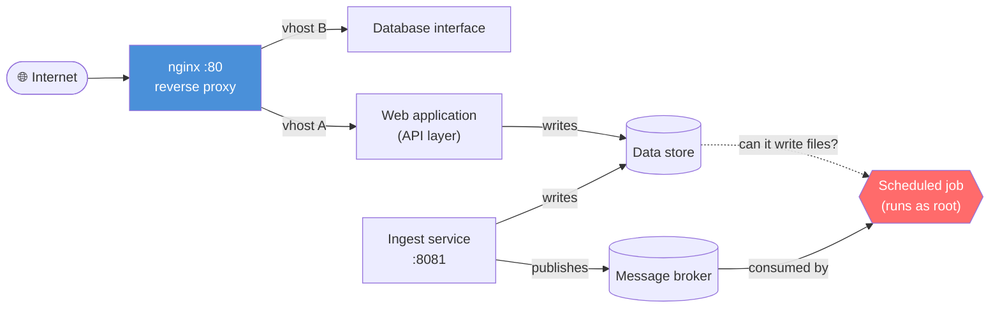
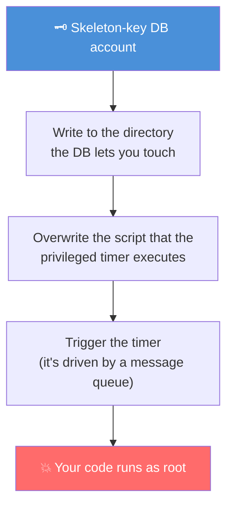
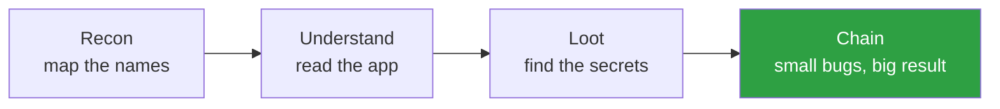

# ✈️ Stream — Hack The Box Walkthrough *(Spoiler-Free Edition)*

> **A guide that gets you unstuck without ruining the box.**
> Every stage below gives you the *shape* of the problem and a nudge in the right direction.
> Reveal more only when you're genuinely stuck — the hints unfold like boarding passes being torn at the gate.

---

## 🛫 Flight Briefing

**Stream** is a small aviation-data exchange — the kind of service that ingests flight-leg
messages from partner airlines, validates them, and stores them for reporting. It's the
classic "internal platform that someone exposed to the internet" story, and the box rewards
you for thinking like the person who *built* it rather than the person who *broke* it.

What makes it a great learning box:

| You will practice | Why it matters in real engagements |
|---|---|
| Virtual-host discovery | Most real apps share one IP; the interesting one is rarely the default page |
| Reading a service like its maintainer | Architecture tells you where the trust boundaries are |
| Credential archaeology | Secrets leak in places nobody thinks to audit |
| Chaining small weaknesses | No single bug here is spectacular — the *chain* is |
| Privileged-process analysis | Finding what runs as root is worth more than any exploit |

**Rules of engagement for this guide:** no flags, no passwords, no copy-paste payloads.
Technique *classes* are named; solutions are yours to build.

---

## 🗺️ The Attack Surface, At A Glance

Two things to notice before you touch anything:

1. **There are more services than there are open ports.** Something is only reachable
   locally — that's a hint about how the box is meant to be traversed.
2. **That red node is the finish line.** A scheduled job that runs as root is almost always
   the end of the chain. Work backwards from it.

---

## 🧭 Phase 1 — Reconnaissance

**Goal:** build a complete picture of the surface before attacking any of it.

The footprint is deliberately small. A loud, fast scan gets you a port list; a *patient*
scan gets you the thing that matters — the names. Virtual hosts are the front door here.

🔎 Hint 1 — the port list looks incomplete

You'll see far fewer services than the application architecture implies. Ask yourself where
the rest of the stack is listening — and what that says about the intended path in.

🔎 Hint 2 — one host, several personalities

The web server answers differently depending on *which name you ask for*. If you're only
browsing by IP address, you're looking at the wrong application.

🔎 Hint 3 — the technique

**Virtual-host enumeration.** Pick a base domain that the box theme suggests, build a
wordlist from the theme's vocabulary (aviation, airports, flight data, ops), and fuzz the
`Host:` header. Two applications live behind that one port — a *user-facing API* and a
*database interface*. You will need both.

> **🧠 Mindset:** resist the urge to attack the first thing you find. Map first. Every
> subsequent phase gets easier once you know what the platform is *supposed* to do.

---

## 🌐 Phase 2 — The Web Application

**Goal:** find how the API accepts input, and what it does with it.

This is a modern service — think "REST API with management endpoints," not a clunky CMS.
Two doors are worth knocking on:

- the **functional endpoint** that takes data from partners, and
- the **management/ops surface** that most teams forget is public.

🔎 Hint 1 — check what the app tells you about itself

Modern frameworks ship a management namespace that exposes health, metrics, config, and
sometimes far worse. Enumerate it the way you'd enumerate any directory — but remember that
the *most valuable* endpoint here isn't the one that returns tidy JSON.

🔎 Hint 2 — the memory doesn't lie

Application frameworks that expose a diagnostics endpoint can leak a **process memory
snapshot**. A heap dump is a frozen moment of everything the app was holding — including
things that were only ever meant to live in memory.

🔎 Hint 3 — classes of bug to hunt

- **Injection into a parser.** The API ingests structured messages from partners. What
  happens if *you* control the structure — not just the values? One well-known parser family
  is happy to fetch things it was never meant to fetch, and to hand you the result.
- **Data flow, not just data.** Once you can influence what the server *fetches*, check
  whether the result lands somewhere you can read it back from. The application talks to a
  different backend than your browser does — follow that trust boundary.
- **Dumps are loot, not noise.** Download the memory snapshot, then treat it like a binary:
  strings, structured search, and patterns for credentials (connection strings, `CREATE
  USER` statements, salts and hashes).

> **🧠 Mindset:** a heap dump is 100 MB of haystack with three needles. Don't eyeball it —
> grep for the words a developer would have typed when *creating* a credential, not the
> words you'd type when *stealing* one.

---

## 🗄️ Phase 3 — The Database Layer

**Goal:** understand what the database can do *for you* — not just what it stores.

You'll reach this service through its own web interface on the second virtual host. The
credentials you recovered in Phase 2 will get you in, but note carefully **which** user you
land as: privileges differ wildly between accounts here.

🔎 Hint 1 — read your own permissions first

Before running a single query, ask the server what you're allowed to do. The answer to
"who am I and what can I touch?" determines everything in this phase.

🔎 Hint 2 — two very different accounts

One account is a model citizen: read and write on a single schema, nothing else. Another
account is a skeleton key. Your job is to get from the first to the second — and the jump
is not a bug in the database, it's a bug in how humans deployed it.

🔎 Hint 3 — what a "file" table function means to you

Analytical databases often ship **table functions that read and write files on the server's
disk**, plus URL fetchers, backup commands, and system introspection. If a database user
can write an arbitrary file *and* a privileged process later executes files from a
predictable location… you've found the rendezvous point.

Ask: *where does this software keep user-accessible files, and who else reads that
directory?*

---

## 🕵️ Phase 4 — Credential Archaeology

**Goal:** upgrade your access by finding the secrets people leave lying around.

Two different kinds of leak, both very common in the real world:

1. **Host-level configuration.** Service configuration files frequently hold live
   credentials in plaintext, and are frequently world-readable. Backups, connection
   strings, and message-broker settings are prime suspects.
2. **Process-level exposure.** Secrets passed as **command-line arguments** are visible to
   anyone who can read the process table — for as long as the process lives.

🔎 Hint 1 — reuse is the vulnerability

The interesting question isn't "what did I find?" but "**where else does this secret
work?**". Operators reuse. A password invented for one control plane very often opens
another. When you find a credential, spray it at every login surface you've mapped —
that's not brute force, that's testing an assumption.

🔎 Hint 2 — watch the watches

There is a process on this box that runs as root on a timer, and it authenticates to the
database **using a password on its command line**. Your goal is to catch that instant.

- Reading `/proc` is fast; the window is short.
- Tools that "help" by parsing the process table may be too slow, or may truncate what you
  need. Consider a tight, purpose-built loop instead.
- The credential may be *zeroed* shortly after the process starts — that's a feature of the
  client, not a bug, and it means you're racing a clock.

🔎 Hint 3 — technique class

**Local process-argument harvesting.** Enumerate `/proc/*/cmdline` on the host as your
low-privilege service account, watching for a specific process name, and extract the argument
that follows a password flag. Run it detached, in a tight loop, long enough to outlast one
timer cycle. Combine with the host-config credential from Hint 1 — one of them is the
skeleton key from Phase 3.

> **🧠 Mindset:** this is the box's centrepiece and it teaches a real lesson — *secrets in
> argv are secrets in `/proc`*. Any blue-teamer reading this should be writing a detection
> rule for it.

---

## 👑 Phase 5 — From Service Account to Root

**Goal:** turn database-level power into code execution as the highest-privileged process.

Put the whole picture together:

Notice what this chain does **not** require: no kernel exploit, no SUID hunt, no fancy
malware. Every hop is a thousand-yard-stare misconfiguration — which is exactly how real
privilege escalation usually looks.

🔎 Hint 1 — find the execution primitive

Enumerate **systemd units and timers** on the host. Look for anything that runs with elevated
privileges on a schedule, and then ask the two magic questions:

- *What does it execute?*
- *Can I write to that file?*

🔎 Hint 2 — how does the timer wake up?

This job isn't a cron-style command — it's a **consumer**. It only does work when there's a
message to process, and the message broker is reachable from the host. Understand the
topic, the consumer group, and what happens to each message as it flows through.

🔎 Hint 3 — technique class

**Writable-script-executed-by-root**, triggered via a message queue.

1. Re-read the privileged job's logic. Note that it shells out to an external formatter
   script and *feeds each message to it*.
2. Locate where that script lives. If it sits in a directory your database account can write
   to, you control code that root will execute.
3. Replace it with something that proves execution — capture `id`, or copy out the
   interesting files — and make it emit output in the format the job expects, so it doesn't
   error out.
4. Publish a message to the right topic to make the consumer fire.
5. Wait for the timer. Patience is part of the exploit.

> **🧠 Mindset:** the elegant move here isn't the payload — it's realising that *the data
> plane can write the code that the control plane executes*. Once you see that shape, you'll
> spot it in production environments for the rest of your career.

---

## 🕳️ Known Rabbit Holes

Save yourself an hour — these are dead ends on this box:

- Hunting for SUID/SGID binaries or capabilities. There aren't any interesting ones.
- Brute-forcing SSH beyond the credential you already found (there's a fail2ban-style ban
  waiting for you).
- Trying to write files as the *low-privileged* database account — that's exactly the
  boundary the box wants you to feel.
- Chasing the high, unexplained port. It's part of the platform's plumbing, not an
  entry point.

---

## 🛡️ Blue-Team Debrief

The most valuable part of this box is what it teaches defenders. Every hop had a cheap fix:

| Chain hop | Control that would have broken it |
|---|---|
| Parser injection via partner messages | Schema validation on ingest; harden the XML/JSON parser against external entity resolution |
| Memory dump exposed publicly | Expose only `health` on the management surface; never leave diagnostics reachable from untrusted networks |
| Plaintext secret in a world-readable config | `chmod 640 root:service`; better, move to systemd `LoadCredential=` / a secret manager |
| Password reused across control planes | Unique credentials per plane, rotated; never reuse a messaging password for SSH |
| Secret visible in `/proc/<pid>/cmdline` | Pass credentials via config file or credential store, never argv |
| Root job executes a data-plane-writable script | Make the executed code root-owned and immutable; verify it (`ExecStartPre=sha256sum -c`) or parse messages in-process |
| Unauthenticated internal message broker | Enable the broker's authorizer, require SASL, disable "allow everyone if no ACL found" |
| No service sandboxing | `ProtectSystem=strict`, `ReadOnlyPaths=`, `NoNewPrivileges=yes`, `PrivateTmp=yes`, dedicated low-privilege UID per service |

**The single highest-leverage change:** stop letting a root service execute code from a
directory another service can write. Everything upstream of that becomes a contained
inconvenience instead of a full compromise.

---

## 🎓 What To Take Away

- **Virtual hosts are not optional recon.** Half this box is invisible until you ask for the
  right name.
- **Privileges are relative.** The same database is a fortress for one account and a
  skeleton key for another.
- **Credential hunting is a skill, not a command.** Knowing *where* to look beats owning
  better wordlists.
- **The chain matters more than the bug.** Security is a graph, and attackers only need one
  path through it.
- **Watch your own processes.** If you can read a secret from `/proc`, so can everyone else.

---

## 📚 Further Reading (technique classes referenced above)

- OWASP — XML External Entity (XXE) prevention cheat sheet
- Application-framework docs — the management/actuator surface, and what should never be
  exposed next to a production app
- Analytical-database docs — table functions that read and write *files* and *URLs* on the
  server, and the "user files" directory they reach
- Message-broker documentation — authentication, ACLs and the authorizer plugin
- `systemd.exec(5)` — sandboxing and hardening directives for services

---

**Happy hacking — and remember: if it was easy to spot, it wouldn't be Medium.** ✈️

*Guide written after completing the box. No flags, credentials, or copy-paste exploits included — by design.*

